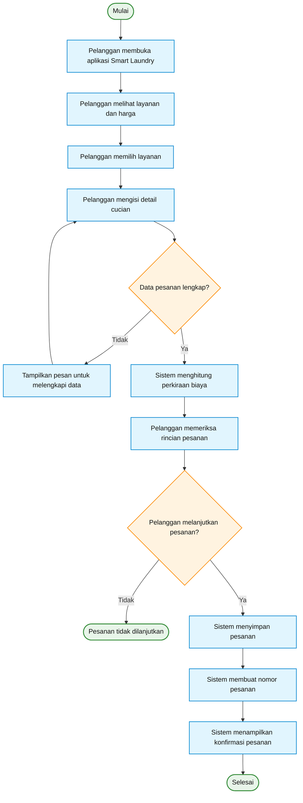

## 8. Activity Diagram — Proses Pemesanan Smart Laundry

Activity Diagram ini menggambarkan alur aktivitas pelanggan ketika membuat pesanan laundry, mulai dari membuka aplikasi hingga pesanan tersimpan atau proses berakhir karena data tidak valid.

### Keterangan Aktivitas

1. **Mulai:** pelanggan membuka aplikasi Smart Laundry.
2. **Memilih layanan:** pelanggan melihat pilihan layanan dan harga, lalu memilih layanan yang dibutuhkan.
3. **Mengisi detail:** pelanggan memasukkan informasi cucian sesuai kebutuhan sistem.
4. **Validasi data:** sistem memeriksa apakah data pesanan sudah lengkap. Jika belum, pelanggan diminta melengkapinya.
5. **Menghitung biaya:** sistem menampilkan perkiraan biaya berdasarkan layanan yang dipilih.
6. **Konfirmasi pelanggan:** pelanggan memeriksa rincian dan menentukan apakah ingin melanjutkan pesanan.
7. **Menyimpan pesanan:** jika pelanggan melanjutkan, sistem menyimpan pesanan dan membuat nomor pesanan.
8. **Selesai:** sistem menampilkan konfirmasi bahwa pesanan berhasil dibuat.

### Tujuan Diagram

Diagram ini membantu menjelaskan urutan aktivitas dalam proses pemesanan Smart Laundry, termasuk keputusan ketika data belum lengkap atau pelanggan tidak melanjutkan pesanan.
