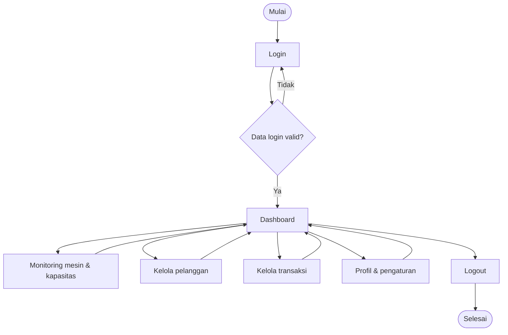

# 🫧 SMART LAUNDRY
### Digital Twin System untuk Monitoring Mesin Cuci & Kapasitas Laundry

**Pantau mesin • Kelola transaksi • Tingkatkan pelayanan**

---

## 🌟 Tentang Smart Laundry

**Smart Laundry** adalah proyek sistem informasi berbasis web dengan konsep **Digital Twin**, yang dirancang untuk membantu pemantauan kondisi mesin cuci dan kapasitas area laundry. Sistem ini juga dirancang untuk mendukung pengelolaan pelanggan serta transaksi laundry melalui satu antarmuka yang mudah digunakan.

Dengan Smart Laundry, informasi status mesin, estimasi sisa waktu pencucian, dan kondisi kapasitas dapat ditampilkan secara lebih terstruktur. Proyek ini masih dalam tahap pengembangan; fitur dan integrasi perangkat fisik dapat disesuaikan dengan hasil implementasi dan pengujian.

## 🎯 Tujuan Proyek

- Memudahkan pemantauan status operasional mesin cuci.
- Menampilkan estimasi sisa waktu proses pencucian.
- Membantu pengguna mengetahui kapasitas area laundry.
- Mendukung pencatatan data pelanggan dan transaksi.
- Menyediakan antarmuka web yang sederhana dan informatif.

## ✨ Fitur yang Dirancang

| Fitur | Deskripsi |
| --- | --- |
| 🔐 Login & Logout | Autentikasi pengguna dan keluar dari sesi aplikasi. |
| 📊 Dashboard | Ringkasan informasi operasional laundry. |
| 🧺 Monitoring Mesin | Menampilkan status mesin aktif atau standby dan estimasi waktu tersisa. |
| 👥 Monitoring Kapasitas | Menampilkan informasi kapasitas/kepadatan area laundry. |
| 🧑‍💼 Manajemen Pelanggan | Menambah dan melihat data pelanggan. |
| 💳 Transaksi Laundry | Memilih pelanggan dan layanan, memasukkan berat, serta menghitung harga. |
| 🧾 Riwayat Transaksi | Menampilkan data dan detail transaksi laundry. |
| ⚙️ Profil & Pengaturan | Menampilkan informasi pengguna dan pengaturan aplikasi. |

> **Catatan:** Daftar di atas merupakan cakupan fitur berdasarkan deskripsi dan rancangan proyek. Belum seluruhnya terverifikasi sebagai fitur yang sudah berfungsi.

## 🔄 Gambaran Alur Sistem

## 🖥️ Rancangan UI/UX

Halaman yang direncanakan: **Login**, **Dashboard**, **Status Mesin**, **Kapasitas Laundry**, **Pelanggan**, **Transaksi**, **Riwayat Transaksi**, serta **Profil**. Mockup dan screenshot akan ditambahkan setelah rancangan final tersedia.

## 🧩 Dokumentasi

Dokumentasi proyek meliputi model context, use case diagram, sequence diagram, activity diagram, rancangan arsitektur, dan desain UI/UX. Lihat folder `UML/`, `Perencanaan proyek/`, dan dokumen `designdanarsiktektur.md` pada repository utama.

## 🛠️ Teknologi

Platform yang dituju adalah **aplikasi web**. Bahasa pemrograman, framework, database, dan mekanisme integrasi Digital Twin akan dicantumkan setelah implementasinya dikonfirmasi.

## 👥 Tim Pengembang

| Nama | Peran | NIM | GitHub |
| --- | --- | --- | --- |
| Ilma Zakiyah | Project Lead | 250504151 | [@ilmazakiyah](https://github.com/ilmazakiyah) |
| Rati Rifa | UI/UX Designer | 250504152 | [@ratirifa](https://github.com/ratirifa) |
| M. Syauqan Athaya | Backend Engineer | 250504164 | [@sauqanathayaa-crypto](https://github.com/sauqanathayaa-crypto) |
## 📌 Status Pengembangan

Proyek sedang dikembangkan dan didokumentasikan sebagai bagian dari kegiatan Rekayasa Perangkat Lunak. Pembaruan diagram, mockup, implementasi, dan pengujian akan dicatat secara bertahap.

---

**Smart Laundry — Solusi Pemantauan Laundry yang Lebih Cerdas 🫧**

[🏠 Repository Utama](https://github.com/RPLUNIT032026/Smart-Laundry-AKT25)

