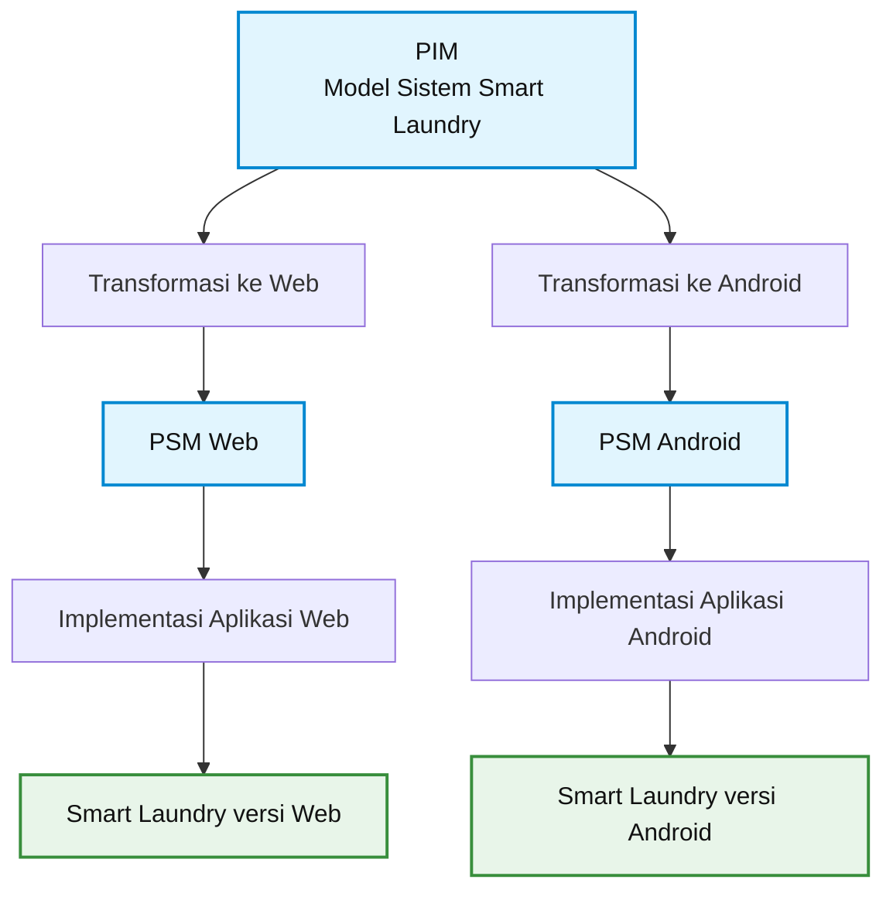
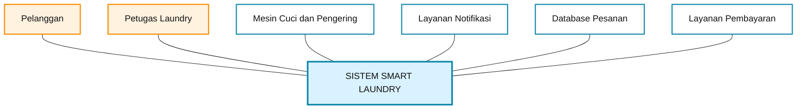

# Dokumentasi Sprint 2 — Smart Laundry

## 1. Gambaran Umum Sistem

**Smart Laundry** adalah sistem pengelolaan laundry berbasis digital yang membantu pelanggan melihat layanan, membuat pesanan, dan memantau status cucian. Petugas laundry dapat mencatat pesanan, memperbarui proses pencucian, serta mengelola data mesin.

Sistem ini juga dapat menerima informasi status mesin dari simulator atau perangkat IoT, sehingga status operasional lebih mudah dipantau.

## 2. Alur MDA Sederhana

Model-Driven Architecture (MDA) menjelaskan bagaimana rancangan sistem dapat dijadikan dasar untuk mengembangkan aplikasi pada platform berbeda.

PIM (Platform Independent Model) adalah rancangan sistem yang belum terikat pada platform tertentu. PSM (Platform Specific Model) menyesuaikan rancangan tersebut dengan teknologi web atau Android.

**Catatan:** Diagram ini menggambarkan konsep MDA. Pembuatan kode otomatis tetap memerlukan alat transformasi atau generator yang sesuai.

## 3. Context Model — Smart Laundry

Context Model memperlihatkan hubungan sistem Smart Laundry dengan pihak dan layanan yang berinteraksi dengannya.

