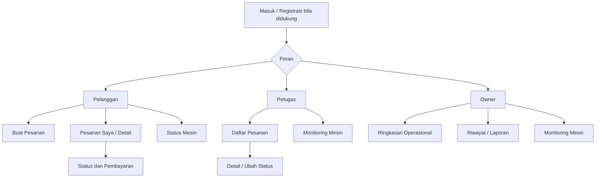

# UI/UX Design — Smart Laundry Digital Twin

## 1. Tujuan
Merancang pengalaman untuk tiga aktor pada Sprint 2: **Pelanggan**, **Petugas**, dan **Owner**, dengan informasi status mesin dari **Mesin/Simulator**. Status pesanan, pembayaran, dan mesin harus ditampilkan terpisah.

## 2. Prinsip UX
- Navigasi sesuai peran; pelanggan tidak mendapat kontrol petugas.
- Setiap status memakai teks dan ikon, bukan warna saja.
- Pesan kesalahan, loading, kosong, dan koneksi terputus tersedia.
- Data Digital Twin menampilkan waktu pembaruan dan label **Simulasi** bila belum memakai sensor nyata.
- Form pesanan menampilkan ringkasan sebelum disimpan.

## 3. Sitemap


## 4. User Flow Utama
**Pelanggan:** masuk → pilih layanan → isi detail pesanan → konfirmasi → lihat nomor pesanan → lihat status/pembayaran.  
**Petugas:** masuk → daftar pesanan → pilih pesanan → verifikasi pembayaran bila diperlukan → tetapkan mesin → perbarui tahap pengerjaan.  
**Owner:** masuk → ringkasan operasional → filter periode → lihat rincian status mesin/pesanan.  
**Digital Twin:** simulator mengirim status → backend memvalidasi → tampilan mesin dan waktu terakhir diperbarui.

## 5. Wireframe Teks (untuk digambar ulang di Figma/draw.io)
### A. Pelanggan — Daftar Pesanan
```text
+--------------------------------------------------+
| SMART LAUNDRY   Pesanan Saya    Status Mesin  Akun |
+--------------------------------------------------+
| [ + Buat Pesanan ]                                |
| Cari nomor pesanan [________]  Status [Semua v]   |
| #SL-001 | Cuci reguler | Diproses | [Detail]      |
| #SL-002 | Cuci cepat   | Selesai  | [Detail]      |
+--------------------------------------------------+
```
### B. Pelanggan — Detail Pesanan
```text
+--------------------------------------------------+
| < Kembali    Pesanan #SL-001                      |
| Layanan: Cuci reguler  Harga: Rp ...              |
| Status Pesanan: Diproses                          |
| Status Pembayaran: Menunggu konfirmasi            |
| Mesin terkait: M-01  | Sedang berjalan            |
| [ Lihat Riwayat Status ] [ Informasi Pembayaran ] |
+--------------------------------------------------+
```
### C. Petugas — Operasional
```text
+--------------------------------------------------+
| SMART LAUNDRY / Panel Petugas                     |
| Pesanan Menunggu [..] Diproses [..] Selesai [..]  |
| [Daftar Pesanan] [Monitoring Mesin]               |
| #SL-001  Menunggu  [Buka] [Proses sesuai izin]    |
| Mesin M-01: Running  | 18 menit | Update 10:32   |
+--------------------------------------------------+
```
### D. Owner — Dashboard
```text
+--------------------------------------------------+
| SMART LAUNDRY / Dashboard Owner                   |
| Periode [Hari ini v]                              |
| Total Pesanan [..] | Selesai [..] | Aktif [..]    |
| [Ringkasan Pesanan] [Status Mesin] [Riwayat]      |
| M-01 Running | M-02 Available | M-03 Maintenance  |
+--------------------------------------------------+
```
### E. Detail Mesin / Digital Twin
```text
+--------------------------------------------------+
| Mesin M-01  [Running] [SIMULASI]                  |
| Sisa waktu: 18 menit                             |
| Pembaruan terakhir: 10:32                        |
| Sumber data: simulator                           |
| Riwayat: Available -> Running -> ...              |
| Jika data terlambat: STATUS BELUM TERKONFIRMASI  |
+--------------------------------------------------+
```

## 6. Komponen UI
- **Warna status (usulan):** tersedia hijau; berjalan biru; selesai teal; perawatan abu-abu; error merah. Sertakan teks.
- **Navigasi:** sidebar desktop, menu ringkas mobile.
- **Form:** label jelas, validasi wajib isi, konfirmasi aksi yang berdampak.
- **Kartu:** status mesin, jumlah pesanan, waktu tersisa, update terakhir.
- **Tabel:** pencarian, filter status, detail, empty state.

## 7. State Antarmuka
Loading; tidak ada pesanan; data simulator terlambat; akses ditolak; gagal menyimpan; berhasil menyimpan; pembayaran belum terkonfirmasi. Jangan menampilkan sukses pembayaran tanpa bukti konfirmasi.

## 8. Matriks Layar dan UML
| Layar | Aktor | Kebutuhan | Diagram Sprint 2 |
|---|---|---|---|
| Buat Pesanan | Pelanggan | FR-02 | Use Case, Sequence Pelanggan |
| Detail/Status Pesanan | Pelanggan | FR-03/04 | State Pesanan |
| Daftar/Proses Pesanan | Petugas | FR-05 | Sequence Petugas |
| Status Mesin | Semua sesuai izin | FR-06/07 | Activity, State Mesin |
| Dashboard Owner | Owner | FR-08 | Sequence Owner |

## 9. Validasi Desain
Dokumen ini adalah **spesifikasi UI/UX dan wireframe teks**, belum mockup visual Figma atau bukti usability testing. Berikutnya buat frame desktop dan mobile, prototipe klik, lalu uji alur ketiga aktor dengan kelompok.
