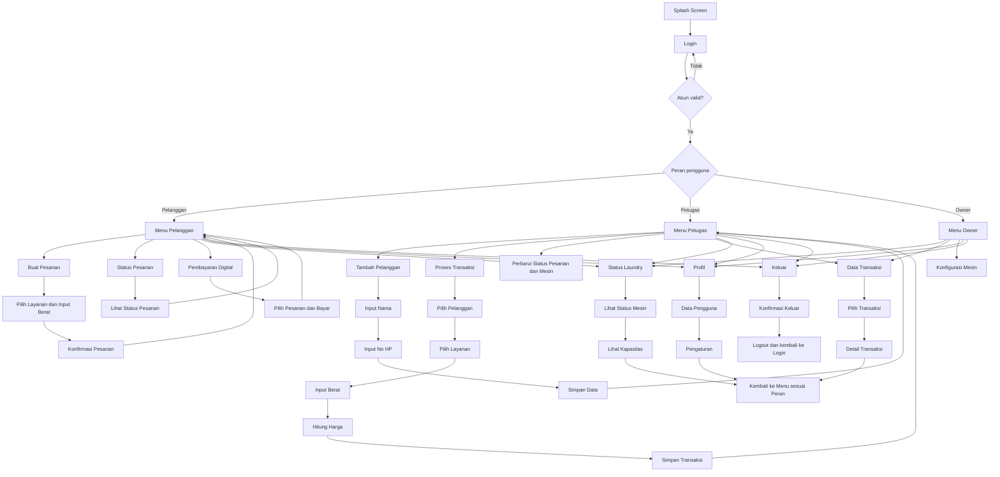
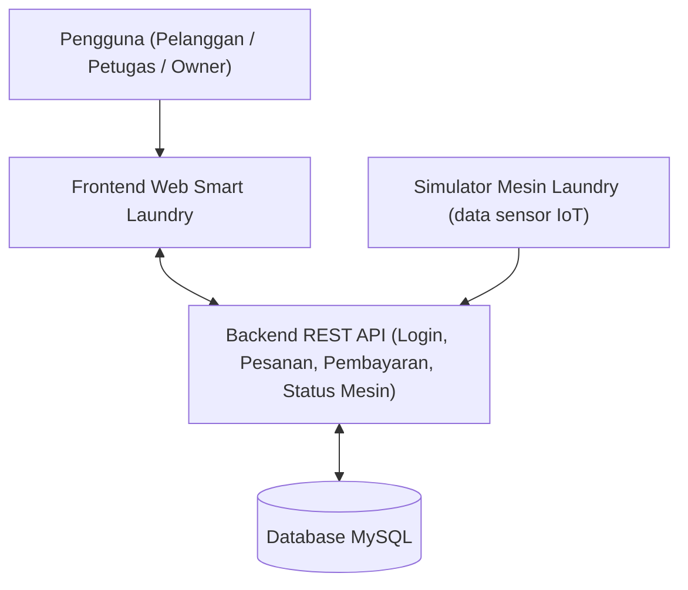
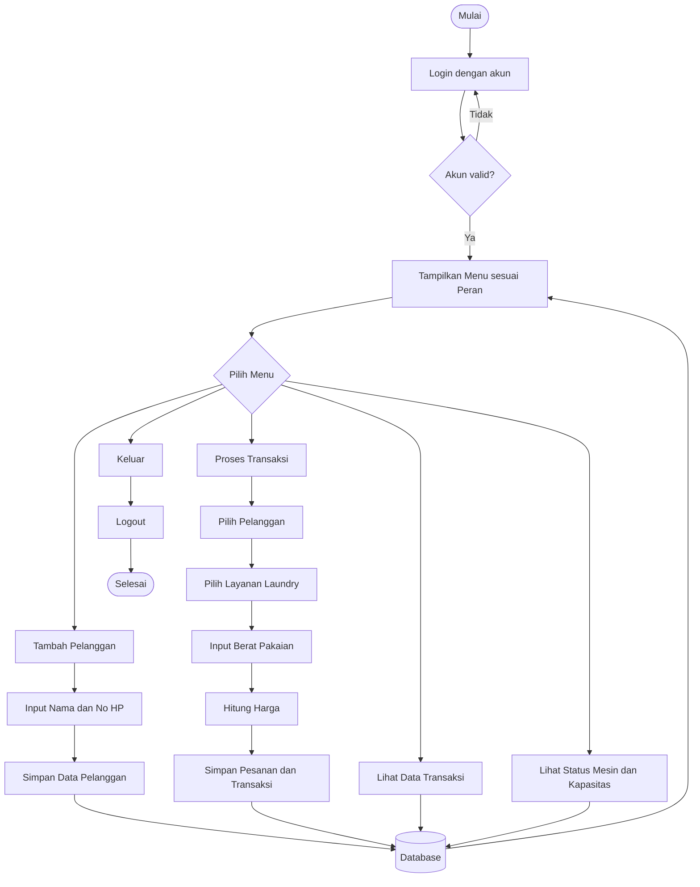
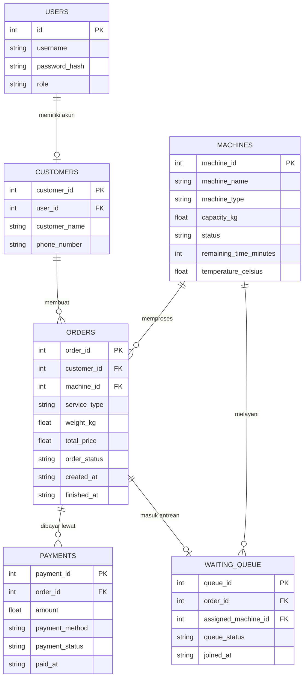

# 2.1 Rancangan UX/UI - Smart Laundry

Aplikasi dipakai oleh tiga aktor, yaitu **Pelanggan**, **Petugas**, dan **Owner** (sesuai Use Case dan Sequence Diagram Sprint 2). Setiap aktor masuk dengan akunnya (pada tahap pengembangan memakai akun dummy) dan melihat menu sesuai perannya.

# 1. Alur Navigasi Aplikasi

Halaman bersama (Status Laundry, Data Transaksi, Profil) selalu kembali ke menu aktor yang sedang login.

# 2.2 Rancangan Sistem

## 1. Arsitektur Sistem

Arsitektur ini sejalan dengan struktur kode pada *Inisialisasi-Kode-Proyek* (`frontend/`, `backend/`, `database/`, `simulator/`). Pembagian komponen dan penempatan perangkat yang lebih rinci dijabarkan pada Component Diagram dan Deployment Diagram di Sprint 2.

---

## 2. Flowchart Sistem

Menu "Tambah Pelanggan" dan "Proses Transaksi" hanya tersedia bagi Petugas; Pelanggan membuat pesanannya sendiri dan Owner melihat data transaksi serta status mesin.

---

## 3. ERD / Struktur Database

Struktur ERD ini identik dengan `database/schema.sql` pada dokumen *Inisialisasi-Kode-Proyek*.

---
