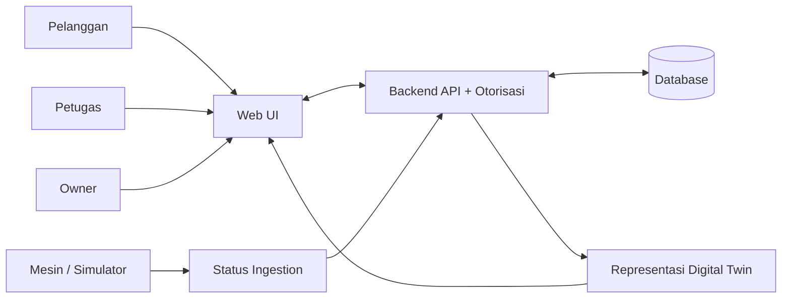
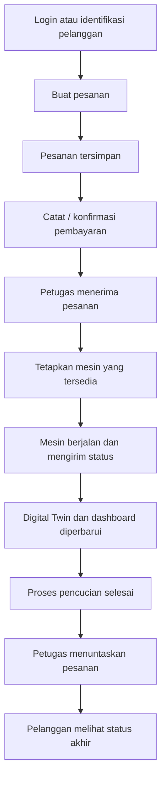
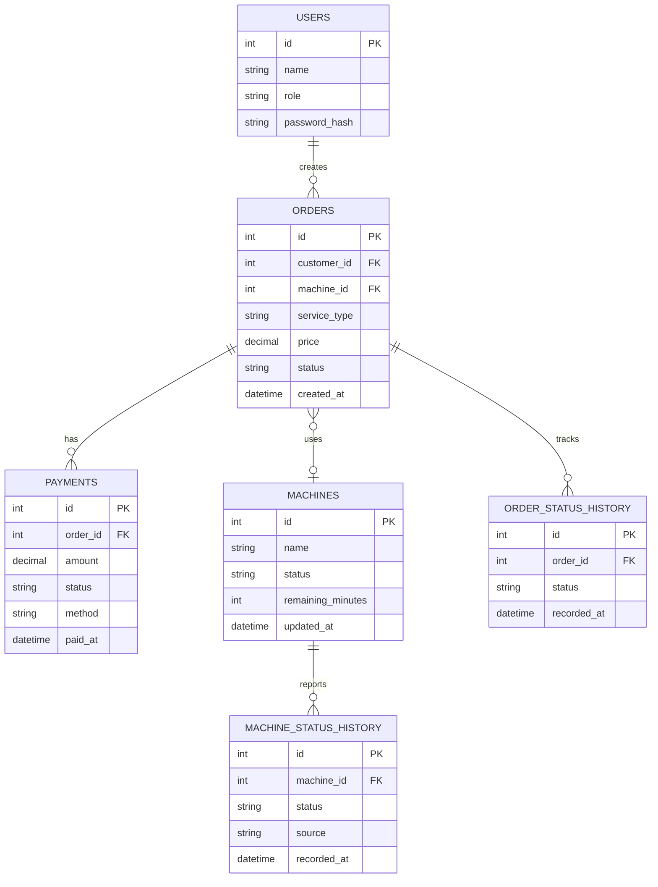

# Desain dan Arsitektur — Smart Laundry Digital Twin

## 1. Konsep Sistem
Smart Laundry adalah aplikasi web layanan laundry dengan Digital Twin mesin. Pelanggan memesan layanan, petugas memproses cucian, owner memantau operasional, dan simulator/perangkat mengirim status mesin. **Status pesanan berbeda dari status mesin.**

## 2. Arsitektur Logis

**Catatan:** diagram ini rancangan, bukan bukti integrasi perangkat nyata.

## 3. Alur Bisnis

Urutan pembayaran terhadap pencucian harus mengikuti aturan yang ditetapkan kelompok dan transisi State Pesanan Sprint 2.

## 4. Model Data Konseptual

**Catatan relasi:** `ORDERS.machine_id` boleh kosong sebelum mesin dialokasikan. Untuk siklus multi-mesin di masa depan, gunakan tabel penugasan terpisah.

## 5. Komponen
- **Frontend:** halaman pelanggan, petugas, owner, dan monitoring.
- **Backend:** autentikasi, pesanan, pembayaran, mesin, riwayat, laporan.
- **Database:** users, orders, payments, machines, riwayat status.
- **Simulator / adapter:** mengirim data status mesin ke backend.
- **Digital Twin service:** memelihara representasi mesin terkini dari update bertimestamp.

## 6. Integritas Status
Pisahkan enumerasi `order_status`, `payment_status`, dan `machine_status`. Nilai akhir harus mengikuti diagram State Sprint 2; jangan menyamakan `Finished` pada pesanan dengan `Available` pada mesin tanpa aturan transisi.

## 7. Keterkaitan UML
Context = aktor dan sistem eksternal; Use Case = kemampuan aktor; Activity = monitoring mesin; Sequence = skenario pelanggan, petugas, owner; State = status pesanan dan mesin; Class = model domain; Component = layanan; Deployment = lokasi runtime.
