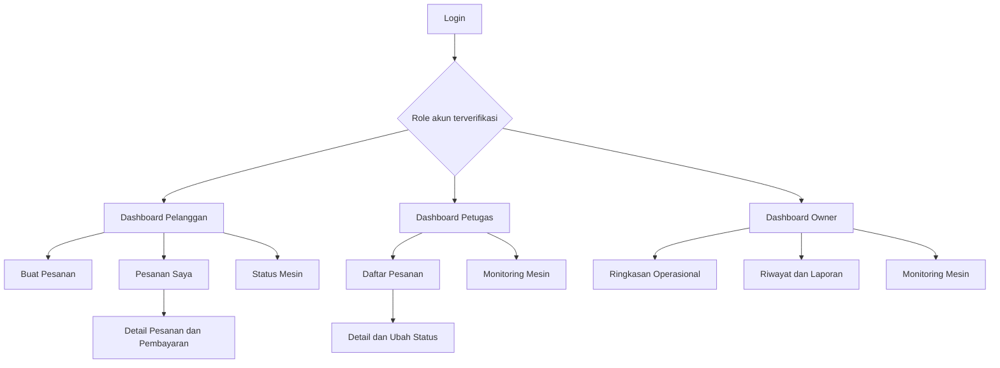
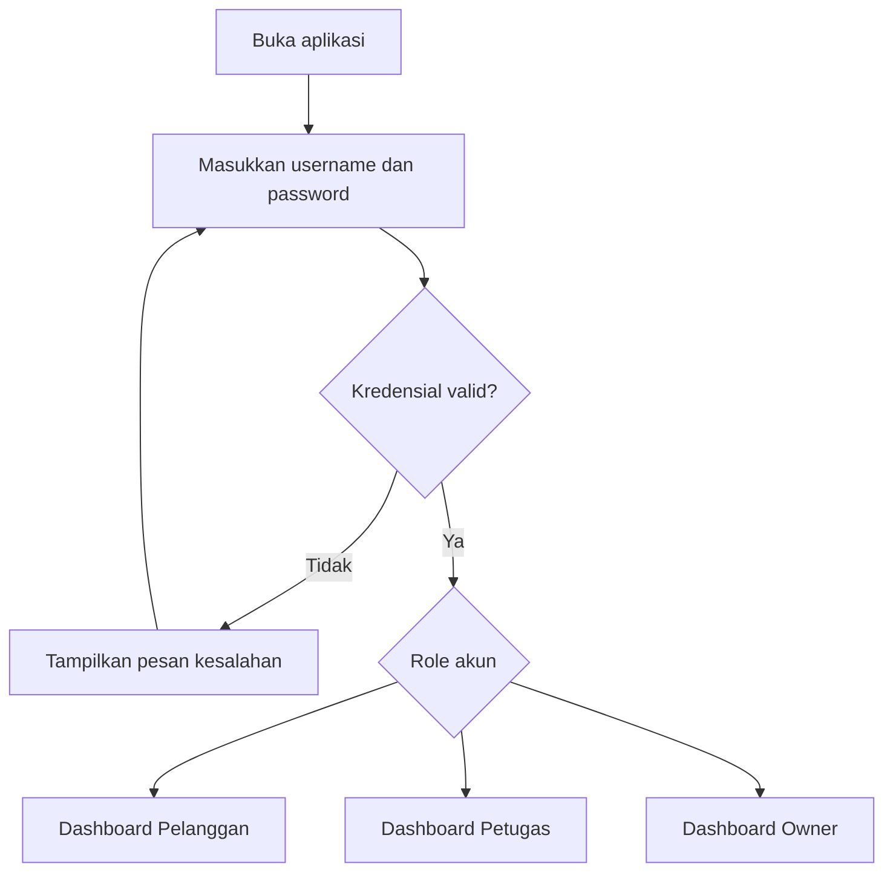
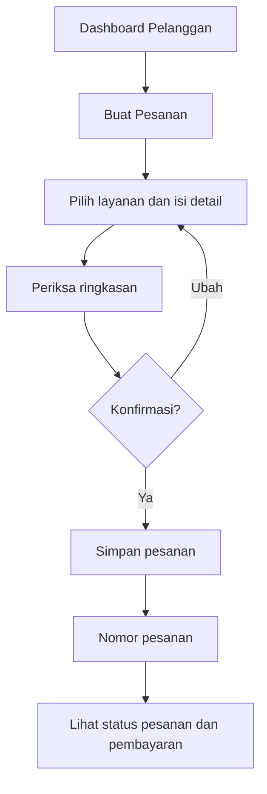
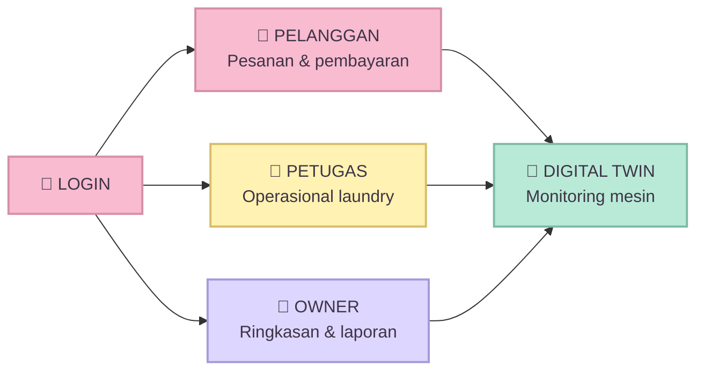

# UI/UX Design — Smart Laundry Digital Twin

> **Sprint 1 — Spesifikasi antarmuka dan pengalaman pengguna**  
> Tema: **Pastel Laundry** (pink muda, kuning muda, lavender, mint).  
> Dokumen ini adalah **rancangan UI/UX**, bukan frontend yang sudah berjalan. Diagram Mermaid dan wireframe dapat dilihat langsung di GitHub.

## 1. Tujuan dan ruang lingkup

Merancang antarmuka responsif untuk tiga aktor yang dijelaskan dalam dokumentasi Sprint 2: **Pelanggan, Petugas, dan Owner**. Sistem mendukung pengelolaan pesanan dan pembayaran serta **Digital Twin** untuk memantau status mesin. Data mesin dapat berasal dari simulator; jangan menyebutnya pembacaan sensor nyata jika belum ada perangkat fisik.

**Prinsip penting:** status **pesanan**, **pembayaran**, dan **mesin** adalah tiga informasi berbeda dan tidak boleh disatukan dalam satu label status.

## 2. Prinsip UX

- Antarmuka sederhana, ramah, responsif, dan mudah digunakan pada HP maupun desktop.
- Navigasi dan izin tindakan mengikuti role akun yang sudah diverifikasi oleh backend. Pengguna **tidak memilih role secara bebas** saat login.
- Warna status selalu didampingi teks atau ikon, sehingga tidak mengandalkan warna saja.
- Aksi penting (membuat pesanan, mengubah status, konfirmasi pembayaran) memerlukan validasi dan umpan balik.
- Tampilkan kondisi *loading*, data kosong, error, akses ditolak, dan koneksi terputus.
- Data Digital Twin menampilkan **sumber data**, **waktu pembaruan terakhir**, dan label **SIMULASI** apabila menggunakan simulator.
- Jika pembaruan data terlambat, tampilkan **Data belum terkonfirmasi**, bukan menyatakan mesin pasti aktif atau tersedia.

## 3. Design System — Pastel Laundry

### 3.1 Palet warna

| Elemen | Warna | Hex | Penggunaan |
|---|---|---|---|
| Primary | Pastel Pink | `#F8BBD0` | Header, tombol utama, menu aktif |
| Primary Hover | Rose Pink | `#F48FB1` | Hover tombol utama |
| Secondary | Butter Yellow | `#FFF2B3` | Kartu informasi, aksen lembut |
| Accent | Soft Lavender | `#DDD6FE` | Tab, ikon, elemen sekunder |
| Success | Mint Green | `#B9EAD7` | Mesin tersedia, konfirmasi berhasil |
| Info | Baby Blue | `#CDE7FF` | Mesin sedang berjalan, informasi |
| Warning | Peach | `#FFE0B2` | Menunggu, antrean, peringatan |
| Danger | Soft Coral | `#FFC9C9` | Error, dibatalkan, gangguan |
| Background | Cream White | `#FFFBF7` | Latar aplikasi |
| Card | White | `#FFFFFF` | Kartu, tabel, formulir |
| Text | Deep Plum | `#3F3447` | Teks utama dengan kontras jelas |
| Muted Text | Slate Gray | `#665E70` | Teks penjelas |
| Border | Soft Lilac Gray | `#E8E1EC` | Garis pembatas dan input |

> **Aksesibilitas:** warna pastel digunakan sebagai latar/aksen, bukan untuk teks kecil berwarna putih. Tombol pink memakai teks gelap `#3F3447`; periksa kontras ketika diimplementasikan.

### 3.2 Tipografi dan komponen

- Font: `Inter`, `Nunito`, `Segoe UI`, atau `sans-serif`.
- H1: 28 px, bold; H2: 22 px, bold; body: 16 px; caption: 14 px.
- Tombol: tinggi minimum 44 px, radius 12 px, teks semibold.
- Kartu: latar putih, radius 16 px, border lembut, bayangan ringan.
- Input: label selalu terlihat, placeholder hanya contoh, pesan error di bawah field.
- Desktop: sidebar dan area konten. Mobile: navigasi ringkas, kartu satu kolom.

### 3.3 Aturan badge status

| Domain | Status contoh | Tampilan |
|---|---|---|
| Mesin | Available / Tersedia | Mint + teks **Tersedia** |
| Mesin | Running / Berjalan | Baby Blue + teks **Berjalan** |
| Mesin | Completed / Selesai | Lavender + teks **Siklus selesai** |
| Mesin | Maintenance / Perawatan | Abu-lavender + teks **Perawatan** |
| Mesin | Error / Gangguan | Coral + teks **Gangguan** |
| Pesanan | Menunggu / Diproses / Selesai / Dibatalkan | Badge dengan label sesuai alur pesanan |
| Pembayaran | Belum dibayar / Menunggu verifikasi / Lunas / Gagal | Badge pembayaran terpisah |

> Nilai status internal harus disamakan dengan State Diagram dan model data Sprint 2 saat implementasi. Label di atas merupakan usulan tampilan, bukan bukti bahwa semua status sudah didukung backend.

## 4. Sitemap



## 5. User Flow

### 5.1 Login



### 5.2 Pelanggan



### 5.3 Petugas dan Owner

- **Petugas:** login → daftar pesanan → buka detail → verifikasi tindakan sesuai izin → tetapkan/lihat mesin terkait → perbarui status → tampilkan hasil.
- **Owner:** login → dashboard → pilih periode → lihat ringkasan pesanan, status mesin, dan riwayat → buka detail bila diperlukan.
- **Digital Twin:** simulator/perangkat → backend menerima dan memvalidasi data → status mesin diperbarui → UI menampilkan status, waktu pembaruan, dan sumber data.

## 6. Wireframe halaman

> Wireframe berikut berupa teks agar mudah dibuat ulang di Figma atau Draw.io. Warna dan tipografi mengikuti Design System pada bagian 3.

### 6.1 Login

```text
+---------------------------------------------------+
|                  SMART LAUNDRY                    |
|              Digital Twin System                 |
|        [ikon mesin cuci pastel pink]              |
|                                                   |
|  Username                                         |
|  [_________________________________]              |
|  Password                                         |
|  [_________________________________] [lihat]      |
|                                                   |
|  [              MASUK              ]              |
|  Pesan error muncul di bawah input bila gagal     |
+---------------------------------------------------+
```

### 6.2 Pelanggan — Dashboard dan Pesanan Saya

```text
+---------------------------------------------------+
| SMART LAUNDRY   Pesanan Saya  Status Mesin  Akun   |
+---------------------------------------------------+
| Hai! Selamat datang kembali                       |
| [ + Buat Pesanan ]                                 |
| [Kartu: Pesanan aktif] [Kartu: Pesanan selesai]    |
| Cari [_____________]  Filter [Semua v]            |
| #SL-001 | Cuci reguler | Diproses | [Detail]       |
| #SL-002 | Cuci cepat   | Selesai  | [Detail]       |
+---------------------------------------------------+
```

### 6.3 Pelanggan — Buat Pesanan

```text
+---------------------------------------------------+
| < Kembali             Buat Pesanan                 |
| Pilih layanan [Cuci reguler            v]         |
| Detail/catatan [_________________________]         |
| Estimasi biaya [Rp ...] (jika tersedia)           |
|                                                   |
| Ringkasan pesanan                                 |
| Layanan: ...    Catatan: ...                      |
| [ Kembali ]             [ Konfirmasi Pesanan ]    |
+---------------------------------------------------+
```

### 6.4 Pelanggan — Detail Pesanan dan Pembayaran

```text
+---------------------------------------------------+
| < Kembali             Pesanan #SL-001              |
| Layanan: Cuci reguler                             |
| Status Pesanan   : Diproses                       |
| Status Pembayaran: Menunggu verifikasi            |
| Mesin terkait    : M-01 (jika sudah ditetapkan)   |
| [Riwayat Status] [Informasi Pembayaran]           |
| Catatan: pembayaran belum dinyatakan lunas        |
+---------------------------------------------------+
```

### 6.5 Petugas — Dashboard Operasional

```text
+---------------------------------------------------+
| SMART LAUNDRY / Panel Petugas                      |
| [Menunggu: ...] [Diproses: ...] [Selesai: ...]     |
| [Daftar Pesanan] [Monitoring Mesin]                |
| #SL-001  Menunggu  [Buka Detail]                   |
| #SL-002  Diproses  [Buka Detail]                   |
| Mesin M-01 | Berjalan | Sisa 18 menit | 10:32      |
+---------------------------------------------------+
```

### 6.6 Petugas — Detail dan Ubah Status

```text
+---------------------------------------------------+
| Pesanan #SL-001                                   |
| Pelanggan: ...    Layanan: ...                    |
| Status saat ini: Menunggu                         |
| Status pembayaran: Belum dibayar                  |
| Mesin terkait: [Pilih mesin jika tersedia v]      |
| Status baru:   [Pilihan yang diizinkan v]         |
| [ Batal ]                 [ Simpan Perubahan ]     |
| Konfirmasi sebelum perubahan penting              |
+---------------------------------------------------+
```

### 6.7 Owner — Dashboard

```text
+---------------------------------------------------+
| SMART LAUNDRY / Dashboard Owner                    |
| Periode [Hari ini v]                              |
| [Total Pesanan] [Selesai] [Sedang Diproses]       |
| [Mesin Tersedia] [Mesin Berjalan] [Gangguan]       |
| Ringkasan Pesanan                                 |
| [Tabel / grafik ringkas bila data tersedia]       |
| [Riwayat] [Lihat Semua Mesin]                     |
+---------------------------------------------------+
```

### 6.8 Monitoring Mesin — Digital Twin

```text
+---------------------------------------------------+
| Monitoring Mesin                 [SIMULASI]        |
| Terakhir diperbarui: 10:32                        |
| [M-01 Berjalan] [M-02 Tersedia] [M-03 Perawatan]  |
|                                                   |
| Detail Mesin M-01                                 |
| Status       : Berjalan                           |
| Sisa waktu   : 18 menit (jika tersedia)           |
| Sumber data  : Simulator                          |
| Riwayat      : Tersedia -> Berjalan               |
| [ Lihat Riwayat ]                                 |
| Jika data terlambat: DATA BELUM TERKONFIRMASI     |
+---------------------------------------------------+
```

### 6.9 Owner — Riwayat dan Laporan

```text
+---------------------------------------------------+
| Riwayat Operasional                               |
| Periode [________] Status [Semua v] [Cari]        |
| Waktu      Jenis Aktivitas      Detail            |
| 10:32      Mesin M-01 berjalan  [Lihat]           |
| 10:05      Pesanan SL-001       [Lihat]           |
| [Halaman sebelumnya] 1 / N [Berikutnya]          |
+---------------------------------------------------+
```

## 7. Contoh tampilan visual menggunakan Mermaid

> Mermaid berikut merupakan **sketsa alur halaman**, bukan screenshot aplikasi. GitHub dapat merendernya langsung.



## 8. Kondisi antarmuka (UI States)

| Kondisi | Perilaku UI |
|---|---|
| Loading | Skeleton atau spinner dan label “Memuat data…” |
| Data kosong | Ilustrasi/ikon sederhana + “Belum ada data” |
| Login gagal | Pesan umum tanpa membocorkan apakah username terdaftar |
| Gagal menyimpan | Jelaskan bahwa perubahan belum tersimpan dan sediakan coba lagi |
| Berhasil menyimpan | Konfirmasi berhasil dan perbarui tampilan |
| Koneksi terputus | Banner peringatan, hindari menampilkan data lama sebagai data terbaru |
| Data mesin terlambat | Label “Data belum terkonfirmasi” + waktu pembaruan terakhir |
| Pembayaran belum terverifikasi | Jangan menampilkan status “Lunas” |
| Akses ditolak | Tampilkan pesan izin tidak mencukupi dan tautan kembali |

## 9. Matriks layar dan UML Sprint 2

| Layar | Aktor | Diagram rujukan Sprint 2 |
|---|---|---|
| Login dan navigasi role | Semua | Use Case, Sequence |
| Buat Pesanan | Pelanggan | Use Case, Activity, Sequence |
| Detail dan Status Pesanan | Pelanggan | State, Sequence |
| Daftar dan Proses Pesanan | Petugas | Use Case, Sequence |
| Dashboard Owner | Owner | Use Case, Sequence |
| Monitoring Mesin | Sesuai hak akses | State Mesin, Activity, Component |
| Detail Mesin dan riwayat | Sesuai hak akses | Class, State, Component |
| Integrasi simulator/backend | Sistem | Component, Deployment |

**Catatan sinkronisasi:** tabel ini menunjukkan dokumen UML yang perlu dicocokkan. Sebelum implementasi, pastikan tiap aksi, role, status, dan relasi memang tersedia pada gambar UML Sprint 2 versi final.

## 10. Rencana validasi dan hasil Sprint 1

- [x] Menentukan konsep visual pastel dan komponen UI.
- [x] Menulis sitemap dan user flow.
- [x] Menyusun wireframe teks untuk halaman utama.
- [x] Mendefinisikan kondisi error, kosong, loading, dan data simulasi.
- [ ] Menggambar mockup visual desktop dan mobile di Figma atau Draw.io.
- [ ] Membuat prototype klik antarhalaman.
- [ ] Melakukan pengujian tugas dengan perwakilan Pelanggan, Petugas, dan Owner.
- [ ] Memverifikasi semua status, role, dan aksi dengan gambar UML Sprint 2 final.

**Status dokumen:** spesifikasi UI/UX siap dipakai sebagai dasar desain visual dan implementasi; belum merupakan aplikasi atau hasil usability testing.
