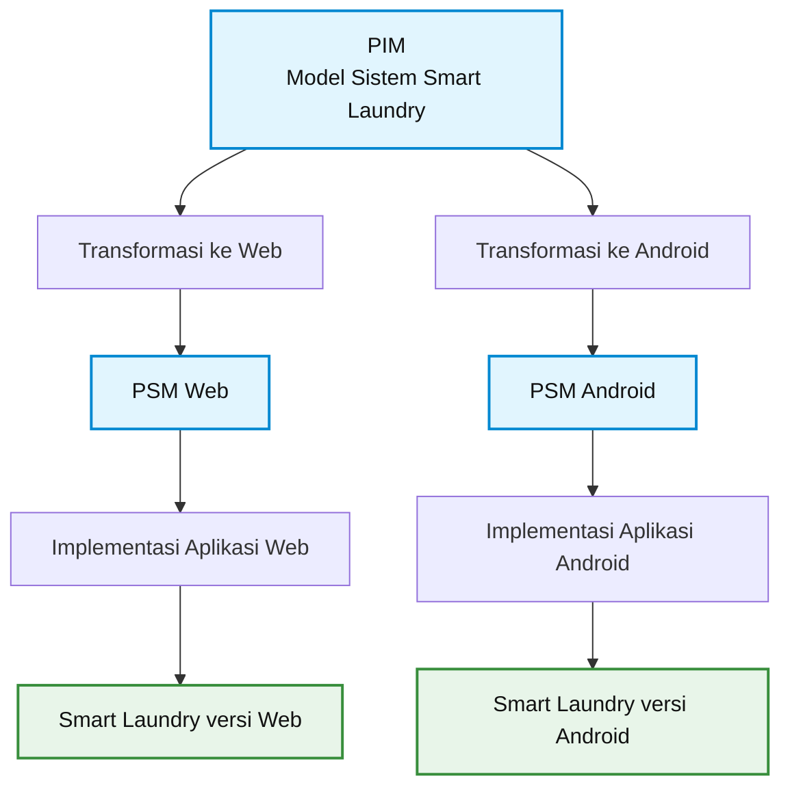
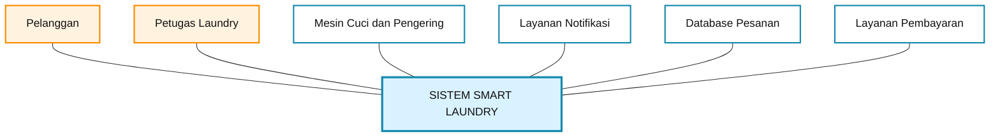
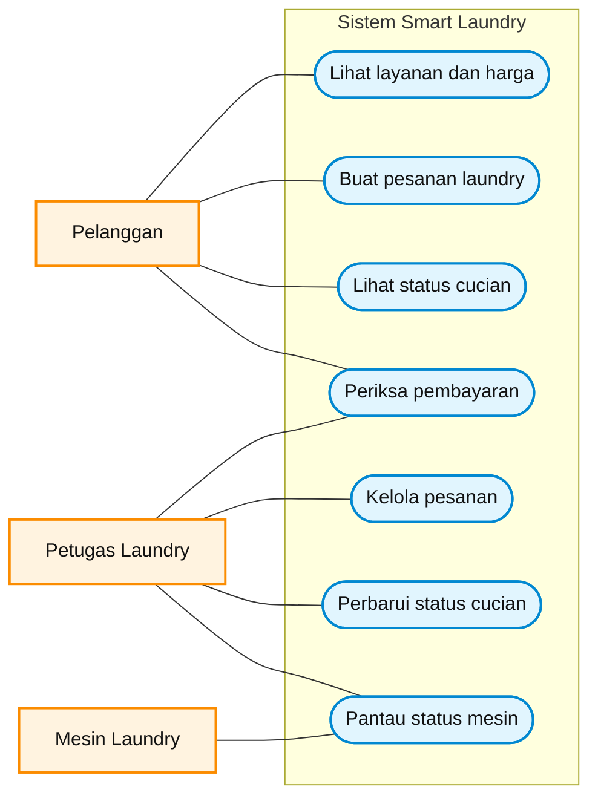
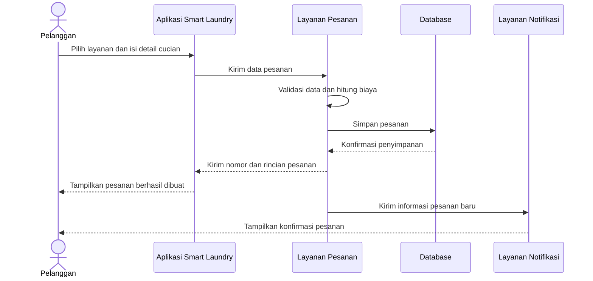
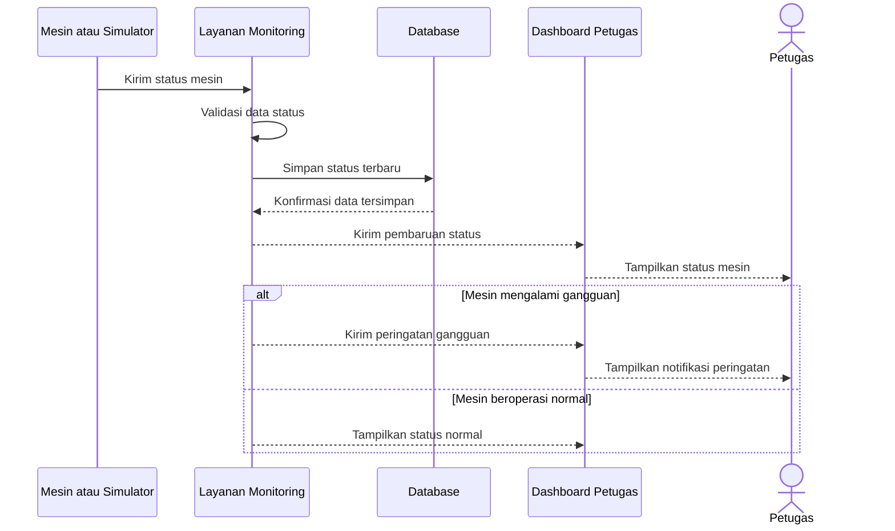
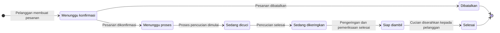
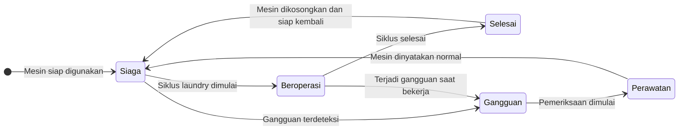

# Dokumentasi Sprint 2 — Smart Laundry

## 1. Gambaran Umum Sistem

**Smart Laundry** adalah sistem pengelolaan laundry berbasis digital yang membantu pelanggan melihat layanan, membuat pesanan, dan memantau status cucian. Petugas laundry dapat mencatat pesanan, memperbarui proses pencucian, serta mengelola data mesin.

Sistem ini juga dapat menerima informasi status mesin dari simulator atau perangkat IoT, sehingga status operasional lebih mudah dipantau.

## 2. Alur MDA Sederhana

Model-Driven Architecture (MDA) menjelaskan bagaimana rancangan sistem dapat dijadikan dasar untuk mengembangkan aplikasi pada platform berbeda.

PIM (Platform Independent Model) adalah rancangan sistem yang belum terikat pada platform tertentu. PSM (Platform Specific Model) menyesuaikan rancangan tersebut dengan teknologi web atau Android.

**Catatan:** Diagram ini menggambarkan konsep MDA. Pembuatan kode otomatis tetap memerlukan alat transformasi atau generator yang sesuai.

## 3. Context Model — Smart Laundry

Context Model memperlihatkan hubungan sistem Smart Laundry dengan pihak dan layanan yang berinteraksi dengannya.

### Keterangan

1. **Pelanggan:** membuat pesanan dan melihat perkembangan cucian.
2. **Petugas Laundry:** mencatat pesanan, mengelola antrean, dan memperbarui status proses.
3. **Mesin Cuci dan Pengering:** menyediakan informasi status mesin, misalnya siaga, beroperasi, atau selesai.
4. **Layanan Notifikasi:** menyampaikan informasi ketika status cucian berubah atau pesanan selesai.
5. **Database Pesanan:** menyimpan data pelanggan, layanan, transaksi, dan status cucian.
6. **Layanan Pembayaran:** mencatat informasi pembayaran pesanan.

## 4. Use Case Diagram

Diagram ini menunjukkan fungsi utama yang digunakan pelanggan dan petugas dalam sistem Smart Laundry.

## 5. Deskripsi Use Case

### Use Case: Membuat Pesanan Laundry

| Elemen | Deskripsi |
|---|---|
| Nama use case | Membuat pesanan laundry |
| Aktor utama | Pelanggan |
| Aktor pendukung | Petugas laundry dan layanan pembayaran |
| Tujuan | Pelanggan membuat pesanan sesuai layanan yang tersedia |
| Prasyarat | Layanan laundry dan harga sudah tercatat dalam sistem |
| Pemicu | Pelanggan memilih layanan dan menekan tombol buat pesanan |
| Alur utama | 1. Pelanggan membuka daftar layanan. 2. Pelanggan memilih layanan dan memasukkan informasi cucian. 3. Sistem menghitung perkiraan biaya. 4. Pelanggan memeriksa rincian pesanan. 5. Sistem menyimpan pesanan dan memberikan nomor pesanan. |
| Alur alternatif | Jika informasi pesanan belum lengkap, sistem meminta pelanggan melengkapinya. Jika layanan tidak tersedia, sistem meminta pelanggan memilih layanan lain. |
| Hasil akhir | Pesanan tercatat dan dapat dipantau melalui aplikasi. |
| Aturan | Harga dan status pesanan mengikuti data yang dikelola oleh pihak laundry. |

## 6. Sequence Diagram

### 6.1 Proses Membuat Pesanan

Diagram ini menunjukkan urutan komunikasi saat pelanggan membuat pesanan laundry.

### 6.2 Pemantauan Status Mesin

Diagram ini menunjukkan bagaimana status mesin diperbarui dan ditampilkan kepada petugas.

## 7. State Diagram

State Diagram menunjukkan perubahan status suatu objek selama proses berlangsung.

### 7.1 Status Pesanan Laundry

| Status | Keterangan |
|---|---|
| Menunggu konfirmasi | Pesanan baru masuk dan menunggu pemeriksaan petugas. |
| Menunggu proses | Pesanan dikonfirmasi dan menunggu giliran pengerjaan. |
| Sedang dicuci | Cucian sedang melalui proses pencucian. |
| Sedang dikeringkan | Cucian berada pada proses pengeringan. |
| Siap diambil | Cucian selesai diproses dan menunggu diambil pelanggan. |
| Selesai | Cucian telah diserahkan kepada pelanggan. |
| Dibatalkan | Pesanan dibatalkan sebelum proses pengerjaan berlangsung. |

### 7.2 Status Mesin Laundry

| Status | Keterangan |
|---|---|
| Siaga | Mesin tersedia dan belum menjalankan siklus. |
| Beroperasi | Mesin sedang menjalankan proses laundry. |
| Selesai | Siklus mesin selesai, tetapi perlu dikosongkan atau diperiksa sebelum digunakan kembali. |
| Gangguan | Sistem mendeteksi masalah sehingga mesin perlu diperiksa. |
| Perawatan | Mesin sedang diperiksa atau diperbaiki oleh petugas. |

## 8. Kesimpulan

Smart Laundry menggabungkan pengelolaan pesanan pelanggan, pemantauan proses cucian, dan pemantauan status mesin. MDA menjelaskan kemungkinan pengembangan rancangan ke platform web dan Android. Context Model memperlihatkan hubungan sistem dengan pihak luar, Use Case menggambarkan fungsi pengguna, Sequence Diagram menunjukkan urutan interaksi, sedangkan State Diagram menjelaskan perubahan status pesanan dan mesin.
